<div align="center">


# synchronize

**Keep every git repository in step across every machine you work on.**

[](https://github.com/FalconTechDev/synchronize/releases/latest)
[](https://go.dev)
[](#install)
[](LICENSE)

[Install](#install) · [How it works](#how-it-works) · [Commands](#command-reference) · [Deployment](#on-a-server) · [Full Guide](GUIDE.md)

</div>

---

You sit down — your work is already there.
You walk away — it is published before the machine goes down.

```bash
syn auto on              # sync at login, every 10 minutes, and before shutdown
syn status all           # what would a sync do right now
syn sync my-repo         # do it now, by hand
```

Repositories stay **ordinary git repositories**. Any git client, GitHub, VS Code — the commits look like commits. `syn` adds no format of its own.

<div align="center">
</div>

---

## How it works

`syn` is a careful wrapper around `git`, run on a timer. Everything follows from that:

- **Nothing is magic.** Anything syn does, you could have typed. When something looks wrong, `git status` in the folder tells you the truth.
- **It commits on your behalf**, so it is careful to say what went into each commit, and takes a backup branch before rewriting anything.
- **It stops rather than guesses.** A conflict halts that repository until you decide — it never merges something half-understood.


<div align="center">
</div>

### Three independent switches

| | What it does | Switch |
|---|---|---|
| **At login** | Brings in everything that changed while you were away | `syn auto login on` |
| **On a timer** | Keeps up while you work — every 10 minutes by default | `syn auto watch on` |
| **At shutdown** | Commits, publishes, and **holds the shutdown** until done | `syn auto shutdown on` |

`syn auto on` turns on all three. None is forced on you.


<div align="center">
</div>

### What a sync actually does

```
  pull  →  fetch, then rebase (or merge) onto the remote
           ↓ anything uncommitted is stashed first and put back after
  push  →  commit what changed, then publish
           ↓ a backup branch is taken before any rewrite
  hooks →  run your command, but only if something actually changed
```

### The watcher

One background process, started by the OS scheduler, that does the above on a
timer. It survives a reboot without syn running. You can always ask what it is
doing:

```console
$ syn status all
  watcher:  running (pid 26676), started 2 hours ago, checked 1 min ago
            next look at my-bot in 9 min
```

### When a conflict happens

<div align="center">
</div>

1. The merge or rebase is **aborted** the moment it goes wrong
2. A **backup branch** `syn/backup/<host>/<branch>/<timestamp>` is taken
3. A **notification** tells you which repository needs you
4. **Syncing stops** for that repository — and stays stopped until you resolve it, so the conflict markers are never committed or pushed

The markers are already in your files at that point; you do not need `resolve`
to see them. If a conflict sits unresolved for more than a day, syn says so
again — once a day — rather than quietly never syncing.

---

## Install

### Windows

Download and run **[`syn-setup.exe`](https://github.com/FalconTechDev/synchronize/releases/latest)**.

- Installs git if you do not have it
- Puts `syn` on your PATH
- No administrator rights required
- Offers to turn on automatic syncing right away

> Windows SmartScreen will call it an unknown publisher — the binary is not
> code-signed. `checksums.txt` in the release lets you verify what you got.

Prefer just the binaries? `syn-windows-amd64.zip` holds both: `syn.exe` for the
terminal and `synw.exe`, the same program without a console window, which is
what autostart runs.

### Linux

```sh
tar xzf syn-server-linux-amd64.tar.gz     # or -arm64
sudo ./install.sh                          # into /usr/local/bin
sudo ./install.sh --service --as deploy    # ...and run from boot
```

> These builds are CGO-free, which makes them ideal on a server and means
> `syn tray` is not expected to work on a Linux desktop. Build from source if
> you want the tray.

### macOS

No prebuilt binaries yet — build from source, it takes a few seconds:

```sh
git clone https://github.com/FalconTechDev/synchronize
cd synchronize
go build -o /usr/local/bin/syn ./cmd/syn/
```

### From source

Requires **Go 1.25+** and **git 2.31+**:

```bash
git clone https://github.com/FalconTechDev/synchronize
cd synchronize

go build -o bin/syn ./cmd/syn/                               # Linux / macOS
go build -o bin/syn.exe ./cmd/syn/                           # Windows
go build -ldflags="-H windowsgui" -o bin/synw.exe ./cmd/syn/ # Windows, for autostart
```

On Windows, build **both**. Autostart runs `synw.exe` precisely because Windows
gives every console program a console — and on Windows 11 that is a terminal
window on screen that nothing in the program can take back. Without it,
autostart falls back to `syn.exe` and you get a black window at every login.

---

## Quick start

<div align="center">
</div>

```bash
syn auth login              # 1. connect your GitHub account
syn repo add owner/name     # 2. clone a repository and track it
syn auto on                 # 3. let it keep up by itself
syn status all              # 4. check on it
```

That is a complete setup.

### Connecting with a token

`syn auth login` asks for a GitHub Personal Access Token.

- **Classic token** — needs the `repo` scope
- **Fine-grained token** — needs *Contents: read/write* per repository

Or pass it directly: `syn auth login --pat ghp_...`

---

## Command reference

> **Every command that touches a repository needs it named.** Use `all` to mean
> every tracked repository. A bare `syn push` is refused by design — you decide
> which repository is being published.

### Signing in

| Command | |
|---|---|
| `syn auth login` | interactive: paste a Personal Access Token |
| `syn auth login --pat <token>` | non-interactive |
| `syn auth status` | who is signed in |
| `syn auth logout` | remove the stored credentials |

### Tracking repositories

<div align="center">
</div>

| Command | |
|---|---|
| `syn init [path]` | register a clone you already have |
| `syn repo add owner/name` | clone from GitHub and track it |
| `syn repo add owner/name --path ./dir` | into a folder you choose |
| `syn repo add owner/name --branch dev` | a second copy on another branch |
| `syn repo add https://gitlab.com/g/t.git` | any git remote, not only GitHub |
| `syn repo create my-project [--public]` | create it on GitHub, then clone |
| `syn repo ls` | what you have on GitHub |
| `syn ls` | what syn is tracking |
| `syn path <repo>` | just the folder, for `cd $(syn path x)` |
| `syn remove <repo>` | stop tracking; the files stay |

### Syncing by hand

<div align="center">
</div>

| Command | |
|---|---|
| `syn pull <repo\|all>` | bring changes in |
| `syn pull <repo> --force` | throw local away, reset to the remote |
| `syn pull <repo> --to v1.4.2` | go to one commit, tag or branch and stay there |
| `syn push <repo\|all>` | commit your work and publish it |
| `syn sync <repo\|all>` | pull, then push |
| `syn status <repo\|all> [--fetch]` | what would happen |
| `syn diff <repo\|all>` | what is not committed yet, untracked included |
| `syn diff <repo> --pushed` | what the remote does not have |
| `syn undo <repo> [--yes]` | take back syn's last commit, keep the changes |
| `syn log [repo] [n] [--live]` | the log, all of it or one repository's |

Add `--dry-run` to `pull`, `push` or `sync` to see what they would do and do
nothing. Worth having for a command that commits on your behalf.

### Automatic syncing

<div align="center">
</div>

| Command | |
|---|---|
| `syn auto` | which of the three switches are on |
| `syn auto login\|watch\|shutdown on\|off` | one at a time |
| `syn auto watch 30m` | and how often (`30m`, `12h`, `1d`) |
| `syn auto on\|off` | all three at once |
| `syn auto <repo> on\|off` | leave one repository out |
| `syn pause <repo> 2h` | the same, but only for a while |
| `syn pause <repo> off` | end the pause early |
| `syn start` | run the watcher now, without waiting for login |

Pausing only affects automatic syncing — commands you type still reach the
repository. The watcher notices a pause set while it is running, so you do not
have to restart it.

### Part of a repository

<div align="center">
</div>

By default the whole repository is synced.

| Command | |
|---|---|
| `syn files <repo>` | which paths are being synced |
| `syn files include <repo> "src/**"` | keep only what matches |
| `syn files exclude <repo> "logs/**"` | keep everything except |
| `syn files clear <repo>` | back to the whole repository |

This is git sparse-checkout: what you leave out is removed from your folder
but stays on the remote, and syn will not commit it as deleted.

To keep a file **on disk but out of automatic commits** — a local `.env`, say
— that is a different thing:

```bash
syn ignore my-repo "*.env"     # hold it back
syn ignore my-repo             # what is being held back
syn ignore my-repo clear
```

### Conflicts

<div align="center">
</div>

| Command | |
|---|---|
| `syn status <repo>` | which files, and where the backup went |
| `syn resolve <repo>` | you have edited the files; finish and sync |
| `syn resolve <repo> --ours` | keep your side everywhere |
| `syn resolve <repo> --theirs` | keep the remote side |
| `syn resolve <repo> --abort` | walk away from the merge or rebase |
| `syn backups <repo>` | safety branches taken before rewrites |
| `syn restore <repo> <branch>` | move back onto one |
| `syn prune <repo\|all> --days 30` | delete the old ones |

```bash
syn status my-repo       # which files are conflicted
# edit them: keep what you want, delete the <<<<<<< ======= >>>>>>> lines
syn resolve my-repo      # sees the markers are gone, finishes and syncs
```

Running `resolve` early is safe: if the markers are still there it says so and
changes nothing.

### Hooks

<div align="center">
</div>

Run a command **on this machine** once a sync has actually changed something.

| Command | |
|---|---|
| `syn hook add <repo> <event> "<cmd>"` | events: `after-pull`, `after-push`, `on-conflict` |
| `syn hook add <repo> <event> --paths "src/**" "<cmd>"` | only when those files changed |
| `syn hook ls` | what is configured |
| `syn hook run <repo> <event>` | try it now, without syncing |
| `syn hook clear <repo> [event]` | remove them |
| `syn hook timeout <repo> 120` | how long a hook may run (default 300s) |
| `syn hook rollback <repo> on\|off` | put the pull back if the hook fails |

The hook is told what happened:

| | |
|---|---|
| `SYN_EVENT` | `after-pull`, `after-push` or `on-conflict` |
| `SYN_REPO` / `SYN_PATH` / `SYN_BRANCH` | which repository, where, on what branch |
| `SYN_COMMIT` / `SYN_PREV_COMMIT` | where it is now, where it started |
| `SYN_CHANGED_FILES` | the paths, **one per line** |
| `SYN_CHANGED_COUNT` | how many |

One path per line because a comma is a legal character in a filename:

```sh
echo "$SYN_CHANGED_FILES" | grep -q "^src/" || exit 0
systemctl restart my-bot
```

### Configuration

```bash
syn config                                  # current settings
syn config set interval_minutes 30m
syn config set strategy merge               # rebase (default) or merge
syn config set backup true                  # branch before any rewrite
syn config set keep_backup_days 14
syn config set commit_template "sync: {host} {time}"
```

Per repository:

| Command | |
|---|---|
| `syn set <repo> interval 12h` | how often this one is checked |
| `syn set <repo> branch dev` | pin it to a branch |
| `syn set <repo> name shorter` | rename it |
| `syn set <repo> autocommit off` | sync only the commits you made yourself |
| `syn set <repo> require_checks on` | never pull a commit whose CI is not green |

**`autocommit off`** is for a repository you develop in rather than one you
just keep in step. syn still pulls, and still pushes the commits you made, but
it stops committing your work in progress every ten minutes — which otherwise
fills the history with `sync: auto-commit` between the commits that mean
something, and sends half-finished work to your other machine.

<div align="center">
</div>

### Alerts

<div align="center">
</div>

```bash
syn config telegram <bot-token> <chat-id>   # conflict alerts to Telegram
syn config telegram                         # what is set (the token is not echoed)
syn config telegram off
syn config test                             # send one now, and find out it works
                                            # today rather than during a conflict
```

The token comes from [@BotFather](https://t.me/BotFather), the chat id from
[@userinfobot](https://t.me/userinfobot). Desktop notifications work without
any of this.

### Ways to look at it

| Command | |
|---|---|
| `syn shell` | a session that stays open, with Tab completion and inline hints |
| `syn tray` | sits by the clock with Pull / Push to hand |
| `syn serve` | dashboard at `http://localhost:7391`, with the log as it happens |
| `syn doctor` | checks git, the account, background syncing, and any repository in trouble |

`syn serve` listens on this machine only. `--addr 127.0.0.1:8080` changes the
port; the bare `--addr :8080` listens on every interface and syn warns you,
because the dashboard can push.

---

## On a server

<div align="center">
</div>

A server is not a machine you work on. Say so, or syncing commits the logs and
caches the running service writes and pushes them to the machines you do work
on.

```bash
syn deploy my-app on      # changes come down; nothing ever goes up
syn deploy                # which repositories are deploy targets
```

### Only deploy what CI approved

```bash
syn set my-app require_checks on
syn pull my-app --no-checks     # ...unless you say otherwise, by hand
```

Reads **both** of GitHub's systems — commit statuses and Actions check runs. A
failure outranks something still running, and if GitHub cannot be reached the
pull stops rather than assume the best.

### Running your program

<div align="center">
</div>

Two commands, and picking the wrong one is the most common mistake.

**`syn restart` — hand over to a service manager you already have.** It runs a
command and *waits for it*:

```bash
syn restart my-bot bot.py --systemd my-bot
syn restart my-bot bot.py -- systemctl restart my-bot
syn restart my-bot run      # try it now, without syncing
```

**`syn app` — syn is the service manager.** For the program itself, which
never returns:

```bash
syn app my-bot -- python bot.py
syn app my-bot --watch "bot.py,src/**" -- python bot.py
syn app my-bot start        # run it here, attached, to try it
```

> Do not put a long-running program in `restart` or in a hook. Both wait for
> the command to finish, so a bot would hold the sync until the hook timeout
> killed it.

An app runs for as long as the watcher does. syn puts its output in the log,
brings it back if it falls over, and gives up after five starts that die
immediately — saying so once rather than retrying forever.

### Running from boot

`syn auto on` installs a **user** service, which on Linux only runs while its
owner has a session. A server needs one that starts at boot with nobody logged
in:

```bash
sudo syn service install --as deploy    # the account owning the repositories
syn service status
sudo syn service uninstall
journalctl -u synchronize -f
```

The unit is sandboxed to its own configuration and the repositories it tracks.
**That list is fixed when the unit is written**, so after `syn repo add` on a
server, run `sudo syn service install` again or the service cannot write to the
new folder.

On Windows there is no separate service: the scheduled task that `syn auto on`
creates already runs from boot.

### Pinning and rolling back

```bash
syn pull my-app --to v1.4.2     # this release, on every machine
syn pull my-app --to v1.4.1     # that one was bad; go back
```

A backup branch is taken first. A bare branch name means the remote's:
`--to main` is the remote's main, not this machine's copy.

### A whole deployment

```bash
syn repo add me/my-bot --path /srv/my-bot
syn deploy my-bot on
syn set my-bot require_checks on
syn set my-bot interval 1m
syn app my-bot -- python bot.py
sudo syn service install --as deploy
```

Push to `main` from your laptop. When CI goes green the server takes it within
the minute and restarts the bot on the new code.

<div align="center">
</div>

---

## Scripting

<div align="center">
</div>

```bash
syn status all --json        # one object per repository
syn status all --porcelain   # name, state, ahead, behind, changed, branch, path
syn path my-repo             # just the folder
```

`--json` also works on `pull`, `push` and `sync`.

**Exit codes.** 0 on success, non-zero on any failure. `status` and `doctor`
answer with their exit code too: non-zero when a repository cannot be read or
has a conflict open, zero when everything is in order. Being ahead or behind is
*not* a failure — that is the normal state between syncs. So this does what it
looks like it does:

```bash
syn status all --json > state.json || notify "syn needs attention"
```

**Non-interactive.** Commands that ask a question refuse when there is nobody
to answer, rather than guessing. Pass `--yes`:

```bash
syn undo my-repo --yes
```

`--yes` only answers the question. `--force` is separate, and additionally
waives the check that the commit was syn's own — so a script cannot rewrite a
commit it was never meant to touch by passing `--yes` alone.

`--quiet` silences stdout; the log file is still written.

---

## Security

**syn never takes a command from a repository.** Hook commands, `restart`
commands and `app` commands all live in `~/.synchronize/config.json` on the
machine that runs them. They never travel through git.

This is the most important property of the tool, and not an accident. If syn
executed a script out of the repository, everyone with push access would have a
shell on every server that pulls it. **A push decides *whether* something runs.
It never decides *what* runs.**

- Tokens live in `~/.synchronize/credentials.json`. On Linux and macOS the file
  is created mode `0600`; on Windows the permissions come from your user
  profile folder, since POSIX mode bits do not map to Windows ACLs.
- Tokens are never written into a remote URL — they reach git through a
  credential helper, for the length of one command.
- `GIT_TERMINAL_PROMPT=0`, so git never sits waiting for a password unattended.
- The dashboard's pull and push endpoints refuse requests a browser reports as
  coming from another site.

See [GUIDE.md → Security model](GUIDE.md#security-model) for the full reasoning,
including the one way you can still defeat it yourself.

---

## Troubleshooting

<div align="center">
</div>

Run **`syn doctor`** first.

| Symptom | Where to look |
|---|---|
| Nothing syncs in the background | `syn status all` now says whether the watcher is running. If not: `syn start`, or `syn auto on` |
| A repository is stuck | `syn status <repo>` — a conflict stops it until resolved |
| A repository never pushes | `syn status <repo>` — it may be a deploy target, or have `autocommit off` |
| A hook did not run | It fires only when the sync **changed** something and its `--paths` matched. `syn hook run <repo> after-pull` runs it regardless |
| A hook failed and you cannot read why | It is in the log: `syn log <repo>` |
| `git fetch` hangs | Network or VPN. Network commands give up after 2 minutes; `SYN_NETWORK_TIMEOUT=30s` changes that |
| A console window at login (Windows) | Autostart must run `synw.exe`. Re-run `syn auto on` after installing both binaries |
| Permission denied on a server | The systemd sandbox — re-run `sudo syn service install` after adding a repository |

The log is `~/.synchronize/synchronize.log`, or the journal when running as a
system service. A repeated failure is logged once rather than every ten
minutes, with a note of how long it has been going on.

---

## Where things live

| | |
|---|---|
| `~/.synchronize/config.json` | repositories, hooks, apps, settings |
| `~/.synchronize/credentials.json` | tokens |
| `~/.synchronize/synchronize.log` | everything syn has done |
| `~/.synchronize/state.json` | last sync times, recorded conflicts |
| `~/.synchronize/watcher.json` | the running watcher's note to itself |

`SYNCHRONIZE_HOME` moves all of it, which is a convenient way to try something
without touching your real setup.

---

## Full reference

Everything above is the common path. [**GUIDE.md**](GUIDE.md) has the complete
command index, the deployment setup end to end, a section addressed to AI
assistants operating syn on your behalf, and an honest list of the things that
will surprise you.

---

## License

MIT — see [LICENSE](LICENSE).
